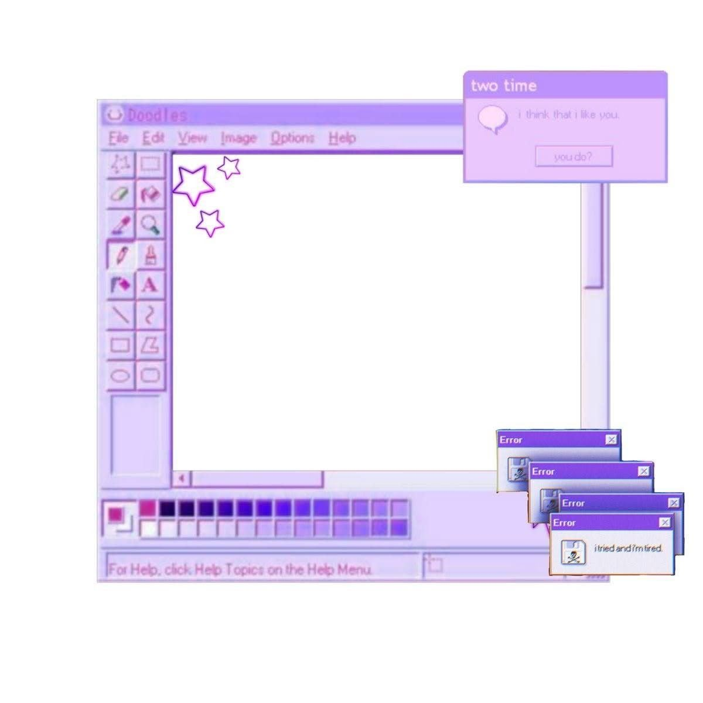
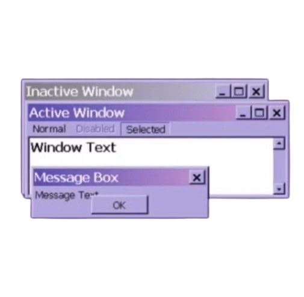
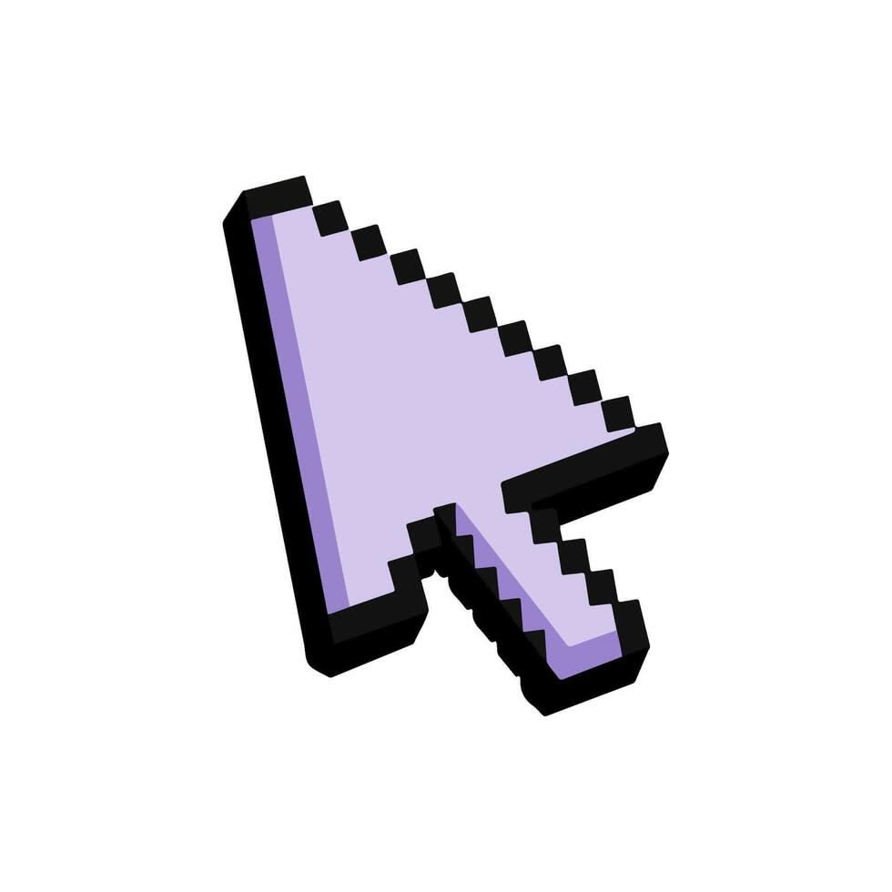
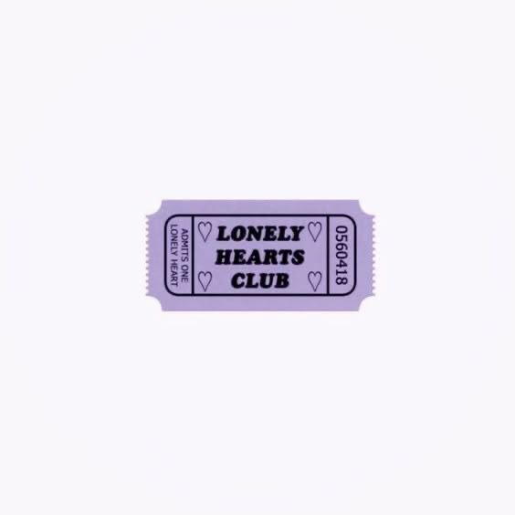
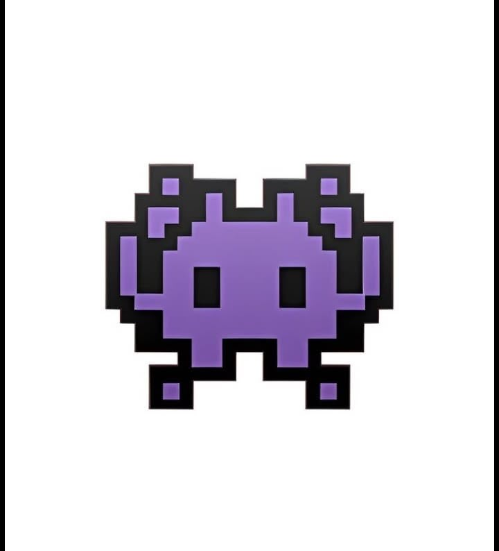
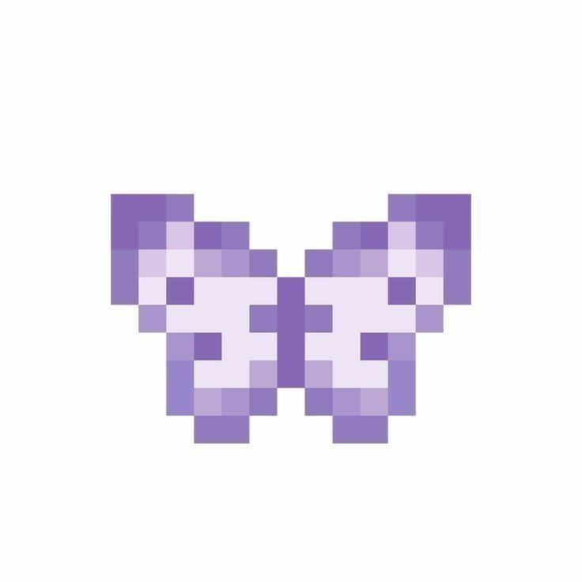
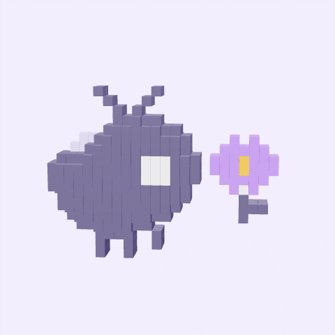

<h1>eyxzz</h1>

  
  
  
  

  
  
  
  
  

  

  
  
  
  
  
  

---

###  Core Focus

*  **Offensive Security & Tooling:** Custom port scanners, vulnerability scanners, honeypot services, and low-level network packet inspection.
*  **Network Protocols & Internals:** Raw TCP/UDP socket engines, custom HTTP/1.1 servers, proxies, and non-blocking I/O multiplexing.
*  **Application Security & Cryptography:** JWT authentication/authorization services, SHA-256 tamper detection, and secure backend architectures.

  
  
   
  

---

###  GitHub Overview

  
  

  
  
  
  

