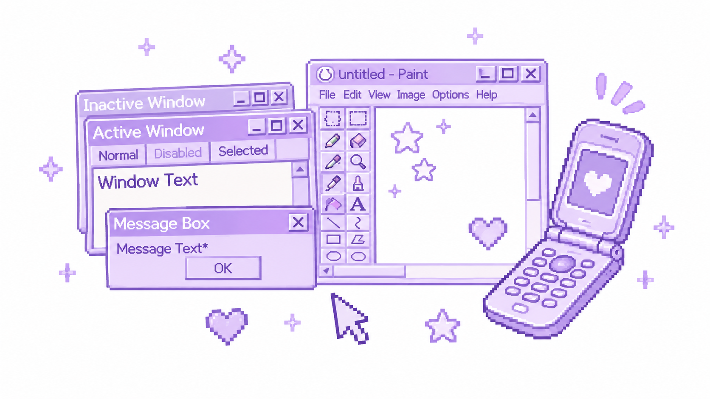
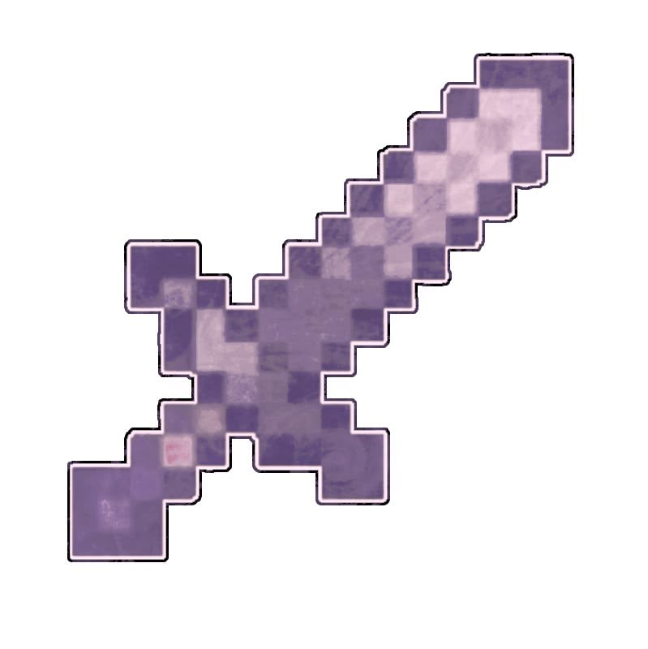

<table>
  <tr>
    <td align="center" valign="middle">
      
    </td>
    <td align="center" valign="middle">
      
    </td>
  </tr>
</table>

 

  

---

###  Core Focus

 **Offensive Security & Tooling:** Custom port scanners, vulnerability scanners, honeypot services, and low-level network packet inspection. 
 **Network Protocols & Internals:** Raw TCP/UDP socket engines, custom HTTP/1.1 servers, proxies, and non-blocking I/O multiplexing. 
 **Application Security & Cryptography:** JWT authentication/authorization services, SHA-256 tamper detection, and secure backend architectures.

   
  
   
  

---

###  GitHub Overview

  

